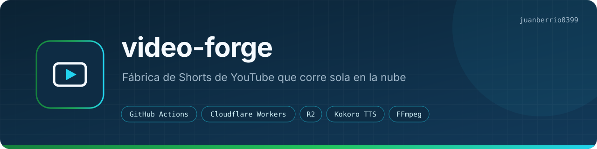
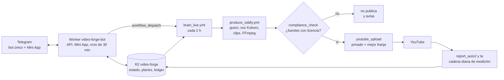

<p align="center"></p>
<p align="center"><a href="README.md">English</a> · <b>Español</b></p>
<p><b>Qué hace:</b> escribe, narra, edita, revisa licencias, sube y programa Shorts de YouTube para dos canales separados, y después mide cómo les fue y decide qué hacer después. Aquí también viven mi único bot de Telegram y Radar, el bot que propone mejoras a mis otros repos.</p>
<p><b>Cómo funciona:</b> GitHub Actions pone el cómputo (guion con IAs gratis, voz Kokoro, clips con licencia, FFmpeg), un Worker de Cloudflare con R2 es el mando y la memoria, y Telegram es la interfaz. Sin PC, sin servidor y con costo de $0 al mes.</p>
<p><a href="https://github.com/juanberrio0399/video-forge/actions/workflows/tests.yml"></a> <a href="https://github.com/juanberrio0399/video-forge/actions/workflows/codeql.yml"></a> <a href="LICENSE"></a> · <a href="https://www.youtube.com/@oddlyloophq">Oddly Loop</a> · <a href="https://www.youtube.com/@TheDataLensHQ">The Data Lens</a></p>

## Por qué existe

Publicar en YouTube con constancia pide un equipo (guion, voz, edición, SEO, agendado) o pagar cada mes herramientas de render. Quise ver hasta dónde llegaba la infraestructura gratis, así que este repo hace ese trabajo con minutos de GitHub Actions, la capa gratis de Cloudflare y APIs de IA gratis.

No solo produce. Cada pieza queda anotada como una decisión con métrica, plazo y criterio de éxito, y un ciclo que corre cada 2 horas la juzga después contra ese criterio. La idea es encontrar un formato que el algoritmo reparta, no sacar volumen por sacar.

Alimenta dos canales reales, separados de punta a punta (estado, credenciales, reportes y agendado nunca se mezclan):

- **[Oddly Loop](https://www.youtube.com/@oddlyloophq)** (`@oddlyloophq`): ASMR, satisfying y animales, con fuentes licenciadas. Va solo, y es el foco hoy.
- **[The Data Lens](https://www.youtube.com/@TheDataLensHQ)** (`@TheDataLensHQ`): datos e historia, faceless, en inglés. Su producción está apagada desde el 2026-10-04; hoy solo se mide.

## Cómo funciona



Así va el ciclo de Oddly Loop, el que corre sin mí:

1. **Decidir.** `brain_live.yml` corre cada 2 horas. Lee de R2 lo que el sistema ya sabe, revisa las decisiones cuyo plazo venció contra su propio criterio (`pipeline/lib/ledger.mjs`) y arma el plan de hoy y mañana con `pipeline/lib/lineup.mjs`. Si las cuentas dicen que el volumen no alcanza la meta, pide cambiar de formato, no producir más.
2. **Producir.** `produce_oddly.yml` escribe el guion (`compilation_script.mjs`, a través de `pipeline/llm.mjs`: Gemini primero y de respaldo Groq, OpenRouter, Workers AI, Cerebras y SambaNova), genera la voz con Kokoro si la variante es narrada, baja de R2 la biblioteca de sonido ASMR y ensambla con `build_compilation.mjs`: clips de Pexels/Pixabay, mezcla de sonido por nicho, grade con LUT y subtítulos.
3. **Revisar licencias.** `compliance_check.mjs` es una puerta dura: si un clip no está en la lista blanca de `channel/auto2/sources.seed.json`, no se publica nada y me llega un aviso.
4. **Subir y programar.** `youtube_upload.mjs` sube **privado** con las credenciales `YT2_*` y declara `containsSyntheticMedia: true`. `best_slot.mjs` elige la siguiente franja libre según `best_hours.json` (las horas que mejor le rinden al propio canal), con tope de 2 por hora.
5. **Medir.** `report_auto2.yml` (cada 2 h) y la cadena diaria (`weekly_stats` → `channel_brain` → `episodes` → `hypotheses` → `retention` → `monetization_report` → `hooks` → `alerts`) escriben las métricas en R2. Eso es lo que lee el cerebro en el paso 1 y lo que muestra la Mini App.

El horario completo, dónde mirar cuando algo falla y la lista de secretos están en [docs/OPERACION.md](docs/OPERACION.md). Por qué está armado así (Actions como granja de render, repo público, Kokoro, cadena de proveedores de texto, puerta legal antes de publicar) está en [docs/DECISIONES.md](docs/DECISIONES.md).

Historias de usuario, flujos y datos: [docs/PRODUCTO.md](docs/PRODUCTO.md).

## Con qué se conecta

- **Bot único de Telegram** (`bot/`, Worker `video-forge-bot`): un solo bot para todo. Los demás Workers se enchufan por service binding (`OSGateway`): Radar (`radar-bot`) y dos sistemas privados míos: una tienda (en pausa) y una app de Windows que edita videos y deja los finales en su propio bucket de R2.
- **Radar** (`radar-bot/` + `radar_scan.yml`, `radar_implement.yml`, `radar_groom.yml`): cada lunes revisa mis repos (la lista está en `radar_scan.yml`: públicos como [serverless-rag-assistant](https://github.com/juanberrio0399/serverless-rag-assistant), [dockerized-data-tool](https://github.com/juanberrio0399/dockerized-data-tool) y [juanberrio0399.github.io](https://github.com/juanberrio0399/juanberrio0399.github.io), y varios privados), abre issues con la etiqueta `radar` y desde la Mini App le puedo pedir al motor un plan verificable para cualquiera de ellos. Los PR automáticos están pausados desde el 2026-09-14, porque 10 de 10 fallaron una revisión a fondo; todo lo reviso antes de mergear.
- **Cloudflare**: Workers, el bucket R2 `video-forge`, Workers AI como respaldo de texto y un Durable Object para que la Mini App se actualice en vivo.
- **APIs externas**: YouTube Data API (un OAuth por canal), Gemini y otras IAs gratis, Pexels, Pixabay, NASA, Wikimedia, Archive y Freesound.

## Cómo correrlo

Los tests y los chequeos de sintaxis corren en cualquier máquina con Node 22:

```bash
npm install                             # instala vitest, la única dependencia de desarrollo
npm test                                # 53 suites de vitest (tests.yml las corre en cada PR)
npx vitest run tests/ledger.test.mjs    # una sola suite
node --check pipeline/brain_live.mjs    # lo que valida build-check.yml
```

La composición del canal principal usa el CLI de HyperFrames, con la versión clavada en `package.json` para que un video vuelva a renderizar igual meses después:

```bash
npm run check        # lint + runtime + layout de la composición
npm run dev          # servidor de preview (queda corriendo)
npm run render       # renderiza a MP4
```

La fábrica en sí no corre en local: se dispara por workflow.

```bash
gh workflow run brain_live.yml                                   # un ciclo del cerebro
gh workflow run produce_oddly.yml -f niche=satisfying -f kind=short
gh workflow run deploy-bot.yml                                   # despliega el Worker (wrangler corre en Actions)
gh run watch                                                     # seguir la corrida
```

Hacen falta los secretos de [docs/OPERACION.md](docs/OPERACION.md#secretos-y-variables) y el alta del bot de [bot/README.md](bot/README.md).

## Estructura

| Carpeta / archivo | Qué hay |
|---|---|
| `pipeline/*.mjs`, `*.py` | ~130 scripts de la fábrica: guion, voz, ensamblaje, YouTube, reportes, cerebro, radar. Cada uno abre con un comentario de qué hace y cuándo corre. |
| `pipeline/lib/` | Lógica **pura** (sin red ni disco): ranking de nichos, scoring, ledger, lineup, cuentas de YPP, alertas. Es lo que cubren los tests. |
| `.github/workflows/` | 84 workflows, uno por paso; se encadenan con `workflow_dispatch` usando el PAT. |
| `bot/` | Worker de Cloudflare: `/api/*`, la Mini App de Telegram (`/os`, `/cerebro`) y el cron de 30 min que compensa los crons que GitHub se salta. |
| `radar-bot/` | Worker aparte: la Mini App de Radar (ejecutar → revisar → merge de PRs). |
| `shared/` | Piezas de UI compartidas por los bots (shell, tokens, la vista unificada de "hoy"). |
| `channel/`, `channel/auto2/` | Semillas de The Data Lens y de Oddly Loop (cadencia, lista blanca de fuentes, nichos, branding). El estado vivo está en R2. |
| `tests/` | Suites de vitest sobre `pipeline/lib/`, el contrato del OS y el bash de los workflows. |
| `clipper/` | Recortador local (no nube) de videos CC-BY. **Apagado desde el 2026-10-24**: su filtro de licencia dejaba pasar material ajeno. |
| `skills/` | Notas de oficio por área (guion, voz, SEO, Shorts, monetización) que alimentan los prompts. |
| `projects/`, `index.html`, `meta.json`, `hyperframes.json` | Composición HyperFrames del canal principal (HTML → MP4). |
| `assets/luts/` | La LUT del grade que aplica el ensamblador. |
| `docs/` | Un documento por tema (tabla abajo). |

## Documentación

| Doc | Qué tiene |
|---|---|
| [docs/ARQUITECTURA.md](docs/ARQUITECTURA.md) | Componentes, el slot de producción, el estado en R2 y la auto-recuperación. |
| [docs/FLUJOS.md](docs/FLUJOS.md) | Los flujos con diagramas: producción de cada canal, agendado, estado, sonido. |
| [docs/PRODUCTO.md](docs/PRODUCTO.md) | Historias de usuario por actor, flujos, datos y conexiones. |
| [docs/OPERACION.md](docs/OPERACION.md) | Horario completo, dónde mirar cuando algo falla, secretos. |
| [docs/DECISIONES.md](docs/DECISIONES.md) | Decisiones de diseño y lo que el proyecto no hace a propósito. |
| [docs/AUDITORIA_CEREBRO.md](docs/AUDITORIA_CEREBRO.md) | Qué medía mal el cerebro, qué se corrigió y cómo se juzga a sí mismo. |
| [docs/CANAL_AUTOMATICO.md](docs/CANAL_AUTOMATICO.md) | Diseño de Oddly Loop: nichos, fuentes legales, fases. |
| [docs/EXPERTO_POR_CATEGORIA.md](docs/EXPERTO_POR_CATEGORIA.md) | Cómo se trabaja una categoría nueva y las reglas de retención. |
| [docs/BRANDING.md](docs/BRANDING.md) | Tipografía, paletas e identidad de canales, bots y Mini Apps. |
| [docs/CONFIABILIDAD_24_7.md](docs/CONFIABILIDAD_24_7.md) | Mapa de fallos y cómo se cierran. |
| [docs/CAPACIDAD_Y_EXPERIMENTOS.md](docs/CAPACIDAD_Y_EXPERIMENTOS.md) | Cuánto puede publicar la fábrica y la rampa de duración. |
| [docs/CRECIMIENTO.md](docs/CRECIMIENTO.md) | Palancas de suscriptores: encadenar videos, CTA, tono. |
| [docs/GROWTH_ROADMAP.md](docs/GROWTH_ROADMAP.md) | Sistema de crecimiento por fases (score, A/B, alertas, cruce). |
| [docs/AI_OS_FASES.md](docs/AI_OS_FASES.md) | Fases del "OS" en Telegram y lo que queda abierto. |
| [docs/DISTRIBUTION.md](docs/DISTRIBUTION.md) | Reparto de Shorts a otras superficies y qué está bloqueado. |
| [docs/DIFUSION.md](docs/DIFUSION.md) | Material de lanzamiento del repo, listo para publicar a mano. |
| [docs/SEGUNDO_CANAL_OAUTH.md](docs/SEGUNDO_CANAL_OAUTH.md) | Crear el 2º canal y sacar sus credenciales `YT2_*`. |
| [docs/miniapp-historias-video-forge.md](docs/miniapp-historias-video-forge.md) | Historias de usuario de la Mini App, mapeadas al código. |
| [docs/miniapp-historias-radar-bot.md](docs/miniapp-historias-radar-bot.md) | Lo mismo para radar-bot. |

## Estado

Oddly Loop está en producción y va solo; The Data Lens solo se mide. Lo que está en juego es el A/B de formato (`un_hecho` contra lista): la mediana por Short estaba en ~46 vistas a comienzos de octubre, así que la palanca es el formato, no el volumen. Qué se hizo, qué sigue y las trampas conocidas están en [PLAN.md](PLAN.md).

## Mantenimiento

Las dependencias las mantiene al día Dependabot, que configuré yo en [`.github/dependabot.yml`](.github/dependabot.yml). Cada PR que abre me lo asigna a mí con la etiqueta `mantenimiento-automatico`, solo entra si pasan las pruebas y los cambios de versión mayor los reviso a mano.

## Licencia y autor

Lo hice yo, **Juan Berrio**. Apache-2.0, © 2025 Juan Berrio. Ver [LICENSE](LICENSE) y [NOTICE](NOTICE).
