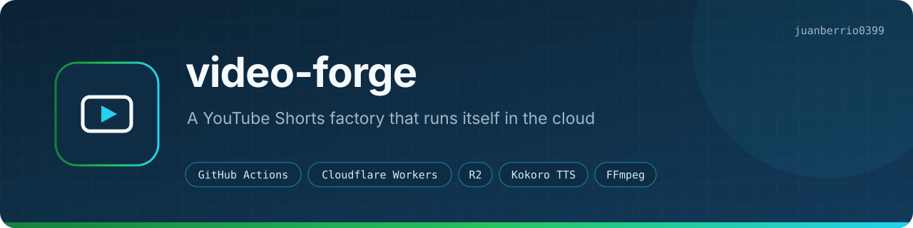
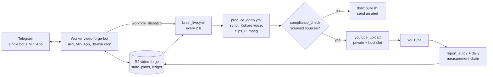

<p align="center"></p>
<p align="center"><b>English</b> · <a href="README.es.md">Español</a></p>
<p><b>What it does:</b> it writes, narrates, edits, license-checks, uploads and schedules YouTube Shorts for two separate channels, then measures how they did and decides what to make next. It also hosts my single Telegram bot and Radar, the bot that proposes improvements to my other repos.</p>
<p><b>How it works:</b> GitHub Actions does the compute (script with free LLMs, Kokoro voice, licensed clips, FFmpeg), a Cloudflare Worker plus R2 hold the controls and the memory, and Telegram is the interface. No PC, no server, $0 a month.</p>
<p><a href="https://github.com/juanberrio0399/video-forge/actions/workflows/tests.yml"></a> <a href="https://github.com/juanberrio0399/video-forge/actions/workflows/codeql.yml"></a> <a href="LICENSE"></a> · <a href="https://www.youtube.com/@oddlyloophq">Oddly Loop</a> · <a href="https://www.youtube.com/@TheDataLensHQ">The Data Lens</a></p>

## Why it exists

Posting on YouTube on a steady schedule takes a team (script, voice, editing, SEO, scheduling) or a monthly subscription to rendering tools. I wanted to see how far free infrastructure could go, so this repo does that work with GitHub Actions minutes, Cloudflare's free tier and free AI APIs.

It doesn't just produce. Every piece is logged as a decision with a metric, a deadline and a success criterion, and a loop that runs every 2 hours checks it against that criterion later. The goal is to find a format the algorithm actually distributes, not to pump out volume.

It feeds two real channels, kept fully separate (state, credentials, reports and scheduling never mix):

- **[Oddly Loop](https://www.youtube.com/@oddlyloophq)** (`@oddlyloophq`): ASMR, satisfying and animal compilations from licensed sources. Fully automatic, and it's the current focus.
- **[The Data Lens](https://www.youtube.com/@TheDataLensHQ)** (`@TheDataLensHQ`): data and history, faceless, in English. Production has been off since 2026-10-04; it's only being measured now.

## How it works



Here's the Oddly Loop cycle, the one that runs without me:

1. **Decide.** `brain_live.yml` runs every 2 hours. It reads what the system already knows from R2, checks decisions whose deadline passed against their own criterion (`pipeline/lib/ledger.mjs`), and builds today's and tomorrow's plan with `pipeline/lib/lineup.mjs`. If the numbers say volume won't reach the goal, it asks for a different format, not more videos.
2. **Produce.** `produce_oddly.yml` writes the script (`compilation_script.mjs`, through `pipeline/llm.mjs`: Gemini first, then Groq, OpenRouter, Workers AI, Cerebras and SambaNova as fallbacks), generates the voice with Kokoro when the variant is narrated, pulls the ASMR sound library from R2 and assembles with `build_compilation.mjs`: Pexels/Pixabay clips, per-niche sound mix, a LUT grade and captions.
3. **Check licenses.** `compliance_check.mjs` is a hard gate. If a clip isn't on the allowlist in `channel/auto2/sources.seed.json`, nothing gets published and I get an alert.
4. **Upload and schedule.** `youtube_upload.mjs` uploads **private** with the `YT2_*` credentials and declares `containsSyntheticMedia: true`. `best_slot.mjs` picks the next free slot from `best_hours.json` (the hours that perform best on the channel's own data), max 2 per hour.
5. **Measure.** `report_auto2.yml` (every 2 h) and the daily chain (`weekly_stats` → `channel_brain` → `episodes` → `hypotheses` → `retention` → `monetization_report` → `hooks` → `alerts`) write metrics to R2. That's what the brain reads in step 1 and what the Mini App shows.

The full schedule, where to look when something breaks and the list of secrets are in [docs/OPERACION.md](docs/OPERACION.md). Why it's built this way (Actions as a render farm, public repo, Kokoro, a chain of LLM providers, a legal gate before publishing) is in [docs/DECISIONES.md](docs/DECISIONES.md). Both are in Spanish.

User stories, flows and data: [docs/PRODUCT.md](docs/PRODUCT.md).

## What it connects to

- **Single Telegram bot** (`bot/`, Worker `video-forge-bot`): one bot for everything. Other Workers plug into it through service bindings (`OSGateway`): Radar (`radar-bot`) and two of my private systems: a store (paused) and a Windows app that edits videos and drops the finals in its own R2 bucket.
- **Radar** (`radar-bot/` + `radar_scan.yml`, `radar_implement.yml`, `radar_groom.yml`): every Monday it scans my repos (the list lives in `radar_scan.yml`: public ones like [serverless-rag-assistant](https://github.com/juanberrio0399/serverless-rag-assistant), [dockerized-data-tool](https://github.com/juanberrio0399/dockerized-data-tool) and [juanberrio0399.github.io](https://github.com/juanberrio0399/juanberrio0399.github.io), plus private ones), opens issues labeled `radar`, and from the Mini App I can ask the engine for a verifiable plan on any of them. Automatic PRs have been paused since 2026-09-14, after 10 out of 10 failed a thorough review; I always review before merging anything.
- **Cloudflare**: Workers, the `video-forge` R2 bucket, Workers AI as a text fallback, and a Durable Object for live updates in the Mini App.
- **External APIs**: YouTube Data API (one OAuth per channel), Gemini and other free LLMs, Pexels, Pixabay, NASA, Wikimedia, Archive and Freesound.

## Running it

Tests and syntax checks run on any machine with Node 22:

```bash
npm install                             # installs vitest, the only dev dependency
npm test                                # 53 vitest suites (tests.yml runs this on every PR)
npx vitest run tests/ledger.test.mjs    # a single suite
node --check pipeline/brain_live.mjs    # what build-check.yml validates
```

The main channel's composition uses the HyperFrames CLI, pinned to a fixed version in `package.json` so a video renders the same months later:

```bash
npm run check        # lint + runtime + layout of the composition
npm run dev          # preview server (keeps running)
npm run render       # renders to MP4
```

The factory itself doesn't run locally; it's triggered by workflow:

```bash
gh workflow run brain_live.yml                                   # one brain cycle
gh workflow run produce_oddly.yml -f niche=satisfying -f kind=short
gh workflow run deploy-bot.yml                                   # deploy the Worker (wrangler runs in Actions)
gh run watch                                                     # follow the run
```

You'll need the secrets listed in [docs/OPERACION.md](docs/OPERACION.md#secretos-y-variables) and the bot setup in [bot/README.md](bot/README.md).

## Layout

| Folder / file | What's inside |
|---|---|
| `pipeline/*.mjs`, `*.py` | ~130 factory scripts: script, voice, assembly, YouTube, reports, brain, radar. Each one opens with a comment on what it does and when it runs. |
| `pipeline/lib/` | **Pure** logic (no network, no disk): niche ranking, scoring, ledger, lineup, YPP math, alerts. That's what the tests cover. |
| `.github/workflows/` | 84 workflows, one per step; they chain through `workflow_dispatch` using the PAT. |
| `bot/` | Cloudflare Worker: `/api/*`, the Telegram Mini App (`/os`, `/cerebro`) and the 30-minute cron that makes up for skipped GitHub crons. |
| `radar-bot/` | Separate Worker: Radar's Mini App (run → review → merge PRs). |
| `shared/` | UI pieces shared by the bots (shell, tokens, the unified "today" view). |
| `channel/`, `channel/auto2/` | Seeds for The Data Lens and Oddly Loop (cadence, source allowlist, niches, branding). Live state lives in R2. |
| `tests/` | vitest suites over `pipeline/lib/`, the OS contract and the workflows' bash. |
| `clipper/` | Local (not cloud) clipper for CC-BY videos. **Off since 2026-10-24**: its license filter let third-party footage through. |
| `skills/` | Craft notes per area (script, voice, SEO, Shorts, monetization) that feed the prompts. |
| `projects/`, `index.html`, `meta.json`, `hyperframes.json` | HyperFrames composition for the main channel (HTML → MP4). |
| `assets/luts/` | The LUT the assembler uses for the grade. |
| `docs/` | One document per topic (table below). |

## Docs

| Doc | What's in it |
|---|---|
| [docs/ARQUITECTURA.md](docs/ARQUITECTURA.md) | Components, the production slot, state in R2 and self-healing. |
| [docs/FLUJOS.md](docs/FLUJOS.md) | Flows with diagrams: production per channel, scheduling, state, sound. |
| [docs/PRODUCT.md](docs/PRODUCT.md) | User stories by actor, flows, data and connections. |
| [docs/OPERACION.md](docs/OPERACION.md) | Full schedule, where to look when things fail, secrets. |
| [docs/DECISIONES.md](docs/DECISIONES.md) | Design decisions and what the project deliberately doesn't do. |
| [docs/AUDITORIA_CEREBRO.md](docs/AUDITORIA_CEREBRO.md) | What the brain measured wrong, what got fixed and how it judges itself. |
| [docs/CANAL_AUTOMATICO.md](docs/CANAL_AUTOMATICO.md) | Oddly Loop's design: niches, legal sources, phases. |
| [docs/EXPERTO_POR_CATEGORIA.md](docs/EXPERTO_POR_CATEGORIA.md) | How a new category gets worked, and the retention rules. |
| [docs/BRANDING.md](docs/BRANDING.md) | Typography, palettes and identity for channels, bots and Mini Apps. |
| [docs/CONFIABILIDAD_24_7.md](docs/CONFIABILIDAD_24_7.md) | Failure map and how each one is closed. |
| [docs/CAPACIDAD_Y_EXPERIMENTOS.md](docs/CAPACIDAD_Y_EXPERIMENTOS.md) | How much the factory can publish and the duration ramp. |
| [docs/CRECIMIENTO.md](docs/CRECIMIENTO.md) | Subscriber levers: chaining videos, CTA, tone. |
| [docs/GROWTH_ROADMAP.md](docs/GROWTH_ROADMAP.md) | Phased growth system (score, A/B, alerts, cross-checks). |
| [docs/AI_OS_FASES.md](docs/AI_OS_FASES.md) | Phases of the Telegram "OS" and what's still open. |
| [docs/DISTRIBUTION.md](docs/DISTRIBUTION.md) | Sending Shorts to other surfaces and what's blocked. |
| [docs/DIFUSION.md](docs/DIFUSION.md) | Launch copy for the repo, ready to post by hand. |
| [docs/SEGUNDO_CANAL_OAUTH.md](docs/SEGUNDO_CANAL_OAUTH.md) | Creating the second channel and getting its `YT2_*` credentials. |
| [docs/miniapp-historias-video-forge.md](docs/miniapp-historias-video-forge.md) | Mini App user stories, mapped to the code. |
| [docs/miniapp-historias-radar-bot.md](docs/miniapp-historias-radar-bot.md) | Same, for radar-bot. |

Most docs are in Spanish.

## Status

Oddly Loop is live and fully automatic; The Data Lens only gets measured. The open question is the format A/B test (`un_hecho` vs. list): the median Short sat around 46 views in early October, so the lever is format, not volume. What's done, what's next and the known gotchas are in [PLAN.md](PLAN.md) (Spanish).

## Maintenance

Dependencies are kept current by Dependabot, which I set up in [`.github/dependabot.yml`](.github/dependabot.yml). Every PR it opens is assigned to me with the `mantenimiento-automatico` label, it only gets merged if the tests pass, and I review major version bumps by hand.

## License and author

Built by **Juan Berrio**. Apache-2.0, © 2025 Juan Berrio. See [LICENSE](LICENSE) and [NOTICE](NOTICE).
