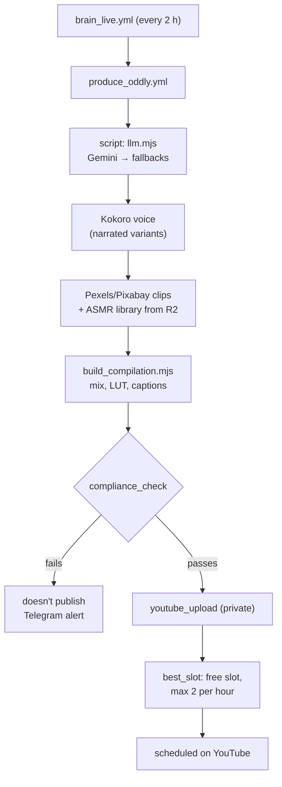
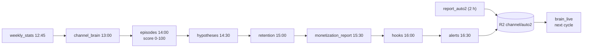
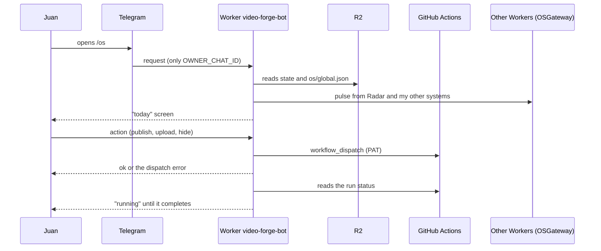
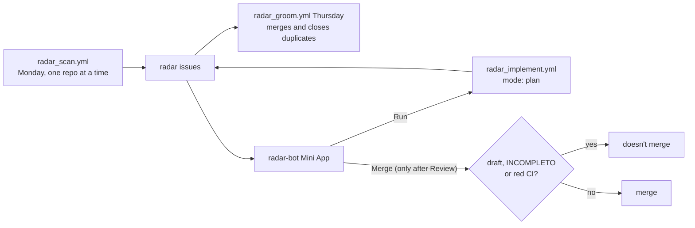
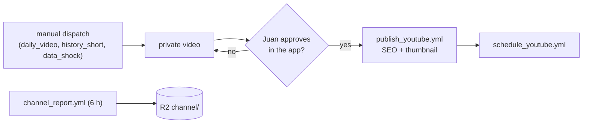
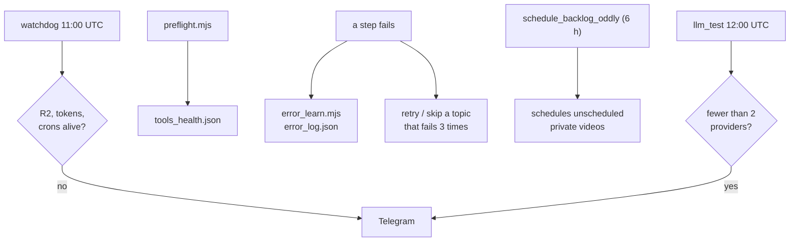
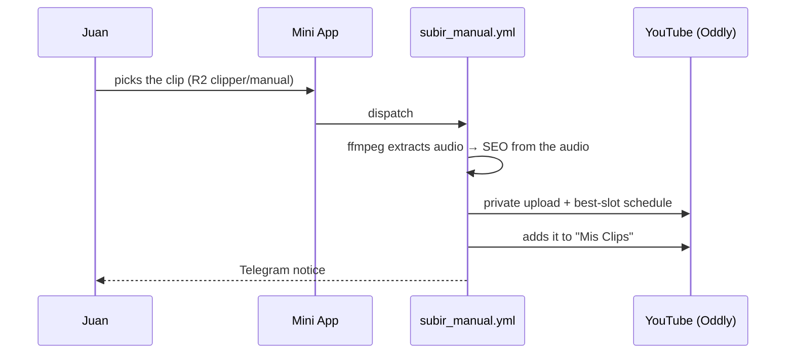
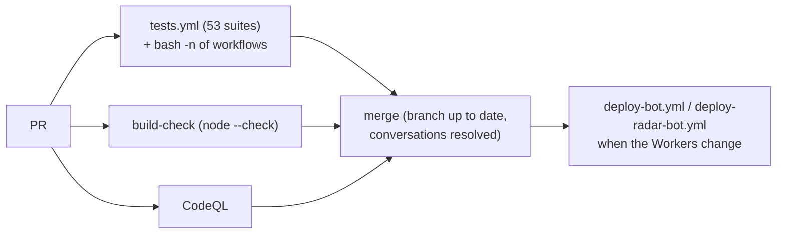

<b>English</b> · <a href="PRODUCTO.md">Español</a>

# video-forge — product

User stories, flows, data and connections for what the repo does today. The overview is in the [README](../README.md).

## Who it's for

- **Day to day (the creator, Juan):** approves, publishes, uploads his own clips and hides videos from the Mini App on his phone.
- **Supervision (Juan reviewing the brain):** checks the decisions the brain made, whether they hit their criterion, and the growth alerts.
- **Owner / business:** wants to know how far the channels are from monetization and what's actually working.
- **Technical (who maintains it):** keeps the workflows, Workers, tokens and free AI providers alive.
- **External:** YouTube viewers and commenters, followers of the public Telegram channel, YouTube itself (policies and quotas), the other repos Radar reviews, and the other Workers that plug into the bot.

## User stories

Grouped by actor. Only what the code does today; what's missing is under [Pending](#pending).

### Day to day (the creator)

#### HU-01 · Control everything from Telegram
**As** the creator **I want** one bot and one Mini App **so that** I can run both channels from my phone without opening GitHub.
**Acceptance criteria**
- The bot only answers `OWNER_CHAT_ID`; any other chat is ignored, and webhooks without the right `X-Telegram-Bot-Api-Secret-Token` are rejected.
- `/os` (and the old `/app`, `/app2` buttons) open the "today" home screen; `/cerebro` opens the brain, decisions, systems and activity.
- Every action the Mini App triggers dispatches its workflow through `workflow_dispatch` with the PAT.
**Where it lives:** `bot/src/index.js`, `shared/hoy-ui.mjs`

#### HU-02 · Publish or schedule an Oddly Loop video
**As** the creator **I want** to publish now or schedule at the best free slot **so that** I don't pick times by hand.
**Acceptance criteria**
- From the Mini App, publishing triggers `publish_oddly.yml` with the video and the mode (now or scheduled).
- Scheduling uses `best_slot.mjs`: first an empty future slot (1 per hour), and when all have one, the first with fewer than 2.
**Where it lives:** `.github/workflows/publish_oddly.yml`, `pipeline/best_slot.mjs`

#### HU-03 · Upload my own clip
**As** the creator **I want** to drop a clip in R2 and have it uploaded with SEO **so that** I can mix my own material in.
**Acceptance criteria**
- `subir_manual.yml` takes `clipper/manual/<cid>.mp4` from R2, extracts the audio, writes SEO from the audio and a hint, uploads it **private** to Oddly Loop, schedules it at the best free slot, marks it as manual, adds it to the "Mis Clips" playlist and notifies on Telegram.
**Where it lives:** `.github/workflows/subir_manual.yml`

#### HU-04 · Approve the Shorts plan for a video
**As** the creator **I want** the system to suggest Shorts from a video and let me approve each one **so that** only what I like gets made.
**Acceptance criteria**
- `shorts_plan.yml` analyzes the video and sends each proposed Short to the chat with Approve/Skip buttons; it doesn't generate anything.
- `shorts_final.yml` (13:00, 19:00 and 01:00 UTC) renders the approved ones and uploads them **private**.
**Where it lives:** `.github/workflows/shorts_plan.yml`, `.github/workflows/shorts_final.yml`

#### HU-05 · Hide a video from the app without deleting it
**As** the creator **I want** to hide a video from the Mini App's board **so that** it stops cluttering the view.
**Acceptance criteria**
- `hide_video.yml` adds the `video_id` to `channel/hidden_videos.json` in R2; it doesn't touch YouTube and `action=show` reverts it.
**Where it lives:** `.github/workflows/hide_video.yml`

### Supervision (reviewing the brain)

#### HU-06 · Every piece is a decision with a criterion
**As** the supervisor **I want** each piece logged with reason, evidence, metric, deadline and criterion **so that** I can judge later whether it worked.
**Acceptance criteria**
- Every 2 hours (minute 15) `brain_live.yml` judges the decisions whose deadline has passed against their own criterion and builds today's and tomorrow's plan, at most 3 pieces per cycle.
- If the numbers say volume won't reach the goal, the plan asks for a format change, not more volume.
**Where it lives:** `pipeline/brain_live.mjs`, `pipeline/lib/ledger.mjs`, `pipeline/lib/lineup.mjs`

#### HU-07 · No conclusions from tiny samples
**As** the supervisor **I want** the system to say "we don't know yet" when there's little data **so that** I don't change production based on 2 videos.
**Acceptance criteria**
- With fewer than 5 videos per arm (`MINIMO = 5`), the verdict is "not enough data"; from 20 (`SOLIDA`) it counts as solid.
**Where it lives:** `pipeline/lib/muestra.mjs`

#### HU-08 · Get alerted only when there's something to do
**As** the supervisor **I want** growth alerts (stalled pipeline, format saturation, dependence on one niche, behind on the goal) **so that** I don't have to check every day.
**Acceptance criteria**
- `alerts.yml` (16:30 UTC) writes `alerts.json` to R2 and only messages Telegram on warn or critical.
- Telegram notices go quiet between 11 p.m. and 5 a.m. Bogotá time.
**Where it lives:** `.github/workflows/alerts.yml`, `pipeline/notify_telegram.sh`

#### HU-09 · Check outside advice against our own data
**As** the supervisor **I want** every external "hack" checked against our numbers **so that** I don't follow advice that doesn't hold here.
**Acceptance criteria**
- `growth_radar.yml` (Sunday 13:00 UTC) researches trends, competition and policies and proposes experiments.
- `cross_validate.yml` (Sunday 18:00 UTC) labels each claim CONFIRMADA, PROBABLE, CONTRADICTORIA, REQUIERE_EXPERIMENTO or INCIERTA against hypotheses, A/B tests and outliers.
**Where it lives:** `.github/workflows/growth_radar.yml`, `.github/workflows/cross_validate.yml`

### Owner / business

#### HU-10 · Know how far we are from monetization
**As** the owner **I want** the real YouTube Partner Program requirements per window **so that** I know whether the goal is realistic.
**Acceptance criteria**
- `monetization_report.yml` (daily 15:30 UTC) measures Shorts views over 90 days, non-Shorts watch hours over 365 days, uploads over 90 days and subscribers, and computes readiness and viability.
- What the API doesn't return shows as "sin dato", never as zero.
- The Brain Report goes to Telegram on Mondays.
**Where it lives:** `pipeline/monetization_report.mjs`, `pipeline/lib/ypp.mjs`

#### HU-11 · Run at $0
**As** the owner **I want** zero fixed cost **so that** the experiment doesn't eat money while it finds its format.
**Acceptance criteria**
- Compute is GitHub Actions (public repo, standard runners at no charge), storage and Workers are on Cloudflare's free plan, and text comes from a chain of free providers.
- `llm_test.yml` checks the chain daily and warns if fewer than 2 providers are left.
**Where it lives:** `pipeline/llm.mjs`, `.github/workflows/llm_test.yml`

### Technical (who maintains it)

#### HU-12 · Find out before something fails silently
**As** the maintainer **I want** a daily watchdog **so that** a dead token or a disabled cron doesn't stop publishing without anyone noticing.
**Acceptance criteria**
- `watchdog.yml` (11:00 UTC) checks R2 access, both channels' YouTube tokens and that production crons are alive (not disabled, not late, not failing repeatedly); it only messages on failure.
- `preflight.mjs` writes `tools_health.json` and `error_learn.mjs` keeps cause and fix of past failures in `error_log.json`.
**Where it lives:** `.github/workflows/watchdog.yml`, `pipeline/preflight.mjs`, `pipeline/error_learn.mjs`

#### HU-13 · Reviewed changes and hands-off bot deploys
**As** the maintainer **I want** tests, syntax checks and CodeQL on every PR, and the bot deployed from the cloud **so that** nothing breaks in production.
**Acceptance criteria**
- `tests.yml` runs the 53 vitest suites; `tests/workflows_bash.test.mjs` passes every `run:` through `bash -n`; `build-check.yml` runs `node --check`; CodeQL runs on PRs and on Mondays.
- `main` is protected: branch up to date and conversations resolved.
- `deploy-bot.yml` deploys the Worker, loads its secrets and registers the Telegram webhook.
**Where it lives:** `.github/workflows/tests.yml`, `build-check.yml`, `codeql.yml`, `deploy-bot.yml`

### External

#### HU-14 · As YouTube: no unlicensed material, AI disclosed
**As** the platform **I want** licensed, transformative content with synthetic media declared **so that** the channel stays within policy.
**Acceptance criteria**
- `compliance_check.mjs` exits 1 (blocks publishing) if a clip isn't on the allowlist or the piece isn't transformative.
- `youtube_upload.mjs` declares `containsSyntheticMedia: true` and uploads private.
**Where it lives:** `pipeline/compliance_check.mjs`, `channel/auto2/sources.seed.json`, `pipeline/youtube_upload.mjs`

#### HU-15 · As a commenter: a short, human reply
**As** someone commenting on a video **I want** a reply that sounds like a person **so that** the channel feels alive.
**Acceptance criteria**
- `comment_reply.yml` (every 6 h) answers new comments on both channels, at most 8 per run per channel, with a de-duplication record in R2.
**Where it lives:** `.github/workflows/comment_reply.yml`

#### HU-16 · As a Telegram channel follower: every new public Short
**As** a follower **I want** to get each new public Short **so that** I can watch and share it.
**Acceptance criteria**
- `telegram_broadcast.yml` (every 6 h) posts each new public Short from both channels, de-duplicated by a ledger; without `DISTRIB_CHANNEL_ID` it does nothing.
**Where it lives:** `.github/workflows/telegram_broadcast.yml`

#### HU-17 · As one of my other repos: an improvement plan, not a surprise PR
**As** a repo Radar reviews **I want** specific issues and a verifiable plan **so that** changes only land with review.
**Acceptance criteria**
- `radar_scan.yml` (Monday 13:00 UTC) scans the repos on its list one at a time and opens `radar` issues; `radar_groom.yml` (Thursday) merges related ones and closes duplicates.
- From the Mini App, "Run" asks `radar_implement.yml` for a plan on the issue (`mode: plan`); automatic PRs have been paused since 2026-09-14 after 10 out of 10 failed review.
- If a PR exists, the Mini App won't merge it if it's a draft, marked `[INCOMPLETO]` or has red CI.
**Where it lives:** `.github/workflows/radar_scan.yml`, `radar_implement.yml`, `radar_groom.yml`, `radar-bot/src/index.js`

#### HU-18 · As another Worker: show up in the same bot
**As** another of my systems (a store, a video-editing app) **I want** to plug into the existing bot **so that** I don't need a bot of my own.
**Acceptance criteria**
- The bot reaches them through service bindings with the `OSGateway` entrypoint (`RADAR`, `VIENTO`, `SIGNAL`).
- `os_orchestrator.yml` (minutes 7 and 37) builds `os/global.json` from each system's pulse; a stale pulse shows as "no signal", never as healthy.
**Where it lives:** `bot/wrangler.toml`, `.github/workflows/os_orchestrator.yml`

## Flows

### 1. Producing an Oddly Loop Short

If a provider has no quota, `llm.mjs` moves to the next; if none answer, the step fails and shows up in Actions and Telegram. A failed schedule gets picked up by `schedule_backlog_oddly.yml` (every 6 h).

### 2. Measure → learn → decide

Each step runs after the one that feeds it. If one fails, the next reads the last state in R2 and the gap shows on the Mini App; the watchdog flags a production cron that's late or failing.

### 3. The single bot and the Mini App

If GitHub rejects the dispatch, the Worker returns `ok: false` with the error and the Mini App shows it instead of a fake "done"; while a run is in progress the home screen shows it as running. The Worker's 30-minute cron makes up for skipped GitHub crons.

### 4. Radar

Repos are scanned one at a time because three in parallel ran out of Gemini's free quota. If the engine can't finish a plan, it labels the issue (`motor-fallo`, `radar-no-valida`).

### 5. The Data Lens (manual, measurement only)

Production has been off since 2026-10-04; only measurement keeps running. Nothing gets published without approval.

### 6. Self-healing

Failure details are in [CONFIABILIDAD_24_7.md](CONFIABILIDAD_24_7.md) (Spanish).

### 7. Uploading a clip of my own

If the upload fails (for example, YouTube's daily upload limit), the run goes red and the notice says so; the clip stays in R2 to retry.

### 8. Code change and deploy

## Data

| Data | Comes from | Stored in | Read by | Sensitivity | Retention |
|---|---|---|---|---|---|
| Live state per channel (`state.json`, cadence, plans) | Workflows | R2 `channel/` and `channel/auto2/` | Brain, Worker, Mini App | Internal | Overwritten; repo `*.seed.json` only if R2 fails |
| Decision ledger | `brain_live` | R2 | Brain, Mini App | Internal | Accumulates |
| Metrics (views, retention, episodes, scores, YPP) | YouTube Analytics/Data API | R2 | Brain, Mini App, alerts | Internal (channel data) | Daily history |
| Failure log and tool health | `error_learn`, `preflight` | R2 `channel/error_log.json`, `tools_health.json` | Brain, maintainer | Internal | Accumulates / overwritten |
| Reference voice and sound library | Juan / Freesound CC0 | Private R2 (`.gitignore` blocks `assets/voice/*.mp3`) | Production | Internal | While in use |
| Videos and clips | Production / Juan | Actions artifacts, R2 `clipper/manual/`, YouTube | YouTube | Public once published | Indefinite on YouTube |
| Radar issues and plans | Radar | GitHub issues of each repo | Juan | Public or private depending on the repo | Until closed |
| YouTube OAuth | Google | GitHub Secrets (`YT_*`, `YT2_*`) | Workflows | Secret | Refresh token doesn't expire (app "In production") |
| AI and footage keys | Providers | GitHub Secrets (`GEMINI_API_KEY`, `GEMINI_API_KEY2`, `GROQ_API_KEY`, `OPENROUTER_API_KEY`, `CEREBRAS_API_KEY`, `SAMBANOVA_API_KEY`, `PEXELS_API_KEY`, `PIXABAY_API_KEY`, `FREESOUND_API_KEY`) | Workflows | Secret | Until rotated |
| Infra and Telegram | Juan | GitHub Secrets and Worker secrets (`CLOUDFLARE_API_TOKEN`, `CLOUDFLARE_ACCOUNT_ID`, `GH_TOKEN`, `TELEGRAM_BOT_TOKEN`, `TELEGRAM_WEBHOOK_SECRET`, `OWNER_CHAT_ID`, `DISTRIB_CHANNEL_ID`) | Workflows, Worker | Secret | Until rotated |

## Connections

| System | What for | How | If it goes down |
|---|---|---|---|
| GitHub Actions | All the compute | Crons + `workflow_dispatch` with the PAT | Nothing gets produced; the Worker's cron retries the dispatch |
| Cloudflare Workers (`video-forge-bot`, `radar-bot`) | Controls, Mini Apps, 30-min cron | HTTP, Telegram webhook, Durable Object | No bot; workflows keep running on their crons |
| Cloudflare R2 `video-forge` | Memory | Worker binding; S3 API from Actions | The brain reads repo seeds; measurements don't save |
| Workers AI | Text fallback | Cloudflare API | `llm.mjs` moves to the next provider |
| YouTube Data / Analytics API | Upload, schedule, measure, reply | OAuth per channel | 429 and 5xx get retried; a credentials error doesn't; the watchdog flags dead tokens |
| Gemini, Groq, OpenRouter, Cerebras, SambaNova | Scripts, SEO, analysis | HTTP APIs | Chain of fallbacks; warns if fewer than 2 are left |
| Pexels, Pixabay, NASA, Wikimedia, Archive, Freesound | Footage and sound | HTTP APIs | Fewer clips available; the compliance gate stays |
| Telegram | Interface, notices, public channel | Bot API | No notices; everything stays in Actions and R2 |
| Other systems of mine (a store, a video-editing app) | Show up in the same bot | Service binding `OSGateway` | Shows as "no signal" in the OS |
| My other repos | Radar reviews them | PAT `GH_TOKEN` | That repo gets skipped that week |

## Pending

- Format A/B verdict (`un_hecho` vs. list) and, depending on that, scale the winner.
- [#152](https://github.com/juanberrio0399/video-forge/issues/152): the HyperFrames CLI is pinned 41 versions behind; [#144](https://github.com/juanberrio0399/video-forge/issues/144): run Kokoro on ONNX only, without PyTorch.
- Open Radar ideas: [#187](https://github.com/juanberrio0399/video-forge/issues/187) (OIDC for Cloudflare), [#181](https://github.com/juanberrio0399/video-forge/issues/181) (FFmpeg.wasm), [#179](https://github.com/juanberrio0399/video-forge/issues/179) (open video model), [#180](https://github.com/juanberrio0399/video-forge/issues/180) (discoverability), [#190](https://github.com/juanberrio0399/video-forge/issues/190) (NOTICE and attribution).
- Radar's automatic PRs stay paused until they pass review.
- Cross-platform distribution: Telegram and Pinterest are in code but Pinterest has no credentials ([DISTRIBUTION.md](DISTRIBUTION.md)).
- Decide what happens to The Data Lens: reactivate, measurement only, or close.
