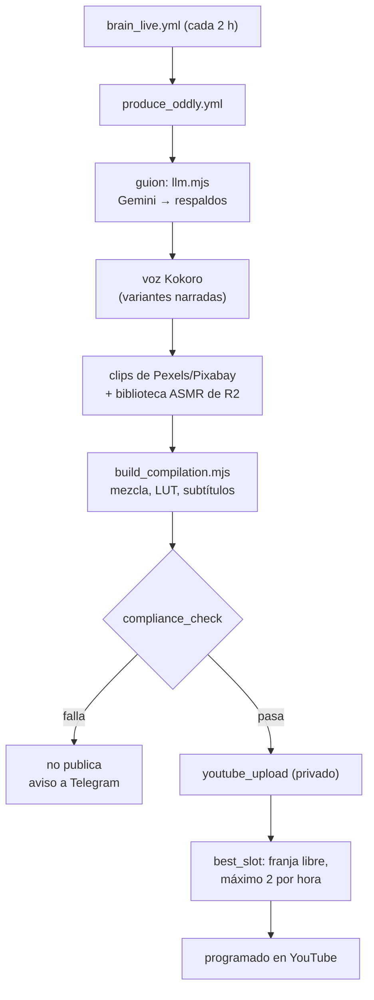
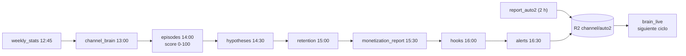
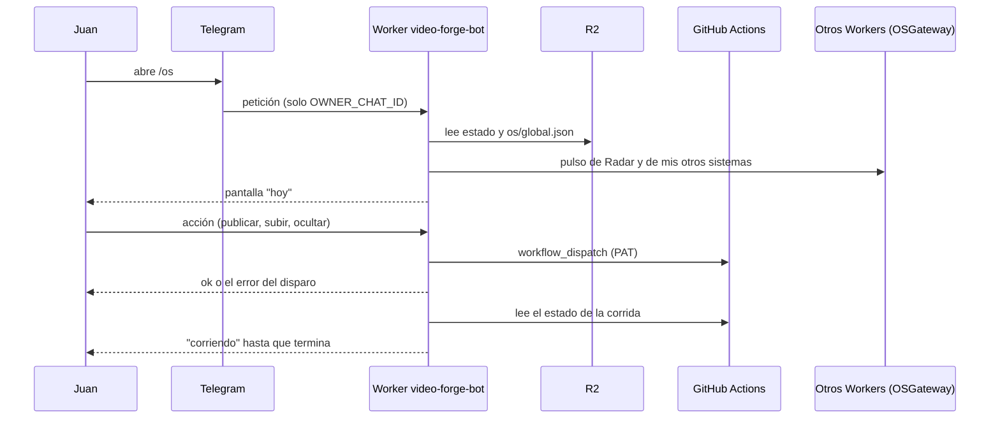
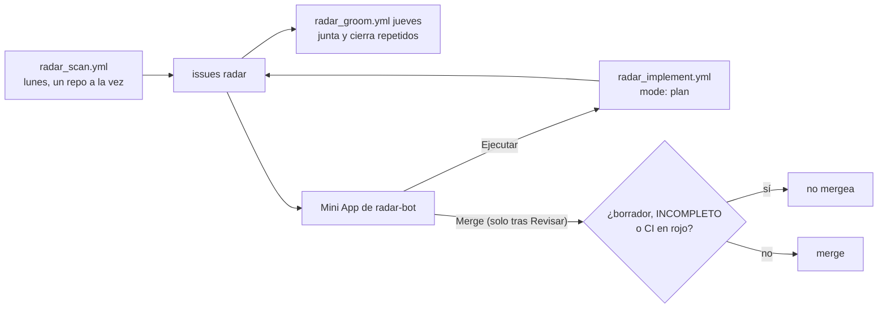
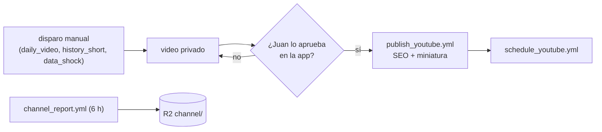
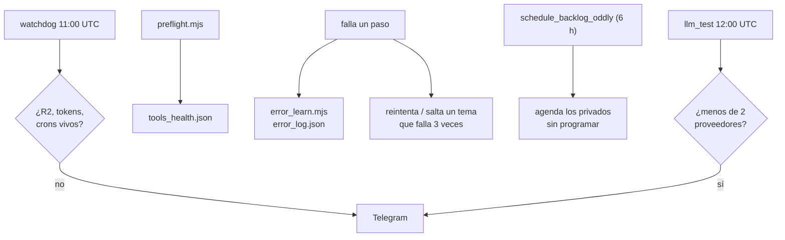
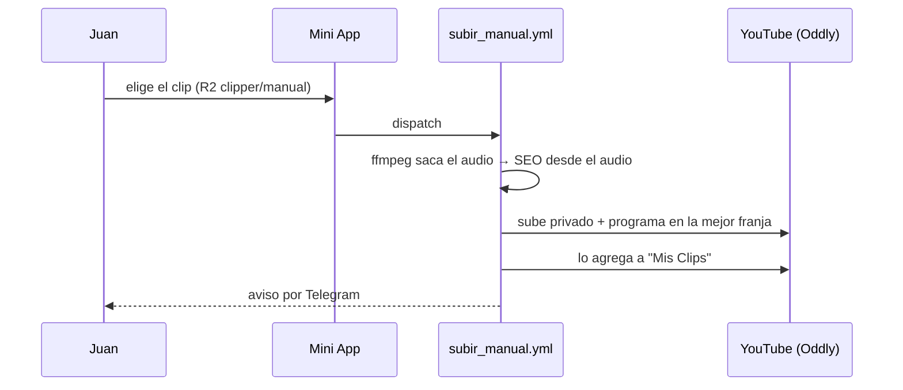
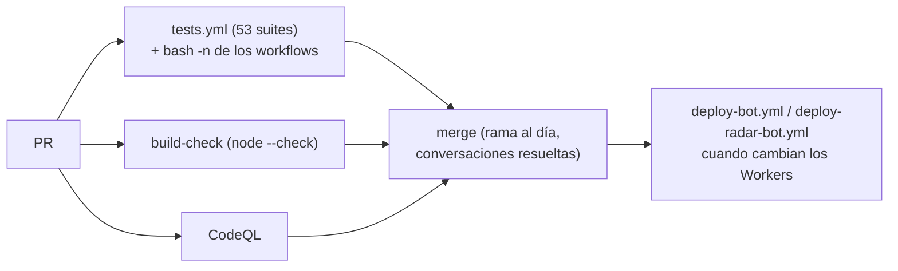

<a href="PRODUCT.md">English</a> · <b>Español</b>

# video-forge — producto

Historias de usuario, flujos, datos y conexiones de lo que el repo hace hoy. El resumen está en el [README](../README.es.md).

## Para quién es

- **Día a día (el creador, Juan):** aprueba, publica, sube clips propios y oculta videos desde la Mini App en el celular.
- **Supervisión (Juan revisando al cerebro):** mira qué decidió el cerebro, si cumplió su criterio y las alertas de crecimiento.
- **Dueño / negocio:** quiere saber qué tan lejos están los canales de monetizar y qué está funcionando de verdad.
- **Técnico (quien lo mantiene):** mantiene vivos los workflows, los Workers, los tokens y las IAs gratis.
- **Externos:** quienes ven y comentan en YouTube, quienes siguen el canal público de Telegram, YouTube mismo (políticas y cuotas), los otros repos que revisa Radar y los otros Workers que se enchufan al bot.

## Historias de usuario

Agrupadas por actor. Solo lo que el código cumple hoy; lo que falta está en [Pendiente](#pendiente).

### Día a día (el creador)

#### HU-01 · Manejar todo desde Telegram
**Como** creador **quiero** un solo bot y una Mini App **para** llevar los dos canales desde el celular sin abrir GitHub.
**Criterios de aceptación**
- El bot solo responde a `OWNER_CHAT_ID`; cualquier otro chat se ignora y los webhooks sin el `X-Telegram-Bot-Api-Secret-Token` correcto se rechazan.
- `/os` (y los botones viejos `/app`, `/app2`) abren la pantalla de inicio "hoy"; `/cerebro` abre cerebro, decisiones, sistemas y actividad.
- Cada acción de la Mini App dispara su workflow por `workflow_dispatch` con el PAT.
**Dónde vive:** `bot/src/index.js`, `shared/hoy-ui.mjs`

#### HU-02 · Publicar o programar un video de Oddly Loop
**Como** creador **quiero** publicar ya o programar en la mejor franja libre **para** no elegir horas a mano.
**Criterios de aceptación**
- Desde la Mini App, publicar dispara `publish_oddly.yml` con el video y el modo (ahora o programado).
- Programar usa `best_slot.mjs`: primero una franja futura vacía (1 por hora) y, cuando todas tienen una, la primera con menos de 2.
**Dónde vive:** `.github/workflows/publish_oddly.yml`, `pipeline/best_slot.mjs`

#### HU-03 · Subir un clip mío
**Como** creador **quiero** dejar un clip en R2 y que se suba con SEO **para** mezclar material propio.
**Criterios de aceptación**
- `subir_manual.yml` toma `clipper/manual/<cid>.mp4` de R2, saca el audio, escribe el SEO a partir del audio y una pista, lo sube **privado** a Oddly Loop, lo programa en la mejor franja libre, lo marca como manual, lo agrega a la playlist "Mis Clips" y avisa por Telegram.
**Dónde vive:** `.github/workflows/subir_manual.yml`

#### HU-04 · Aprobar el plan de Shorts de un video
**Como** creador **quiero** que el sistema proponga Shorts de un video y yo apruebe uno por uno **para** que solo se haga lo que me gusta.
**Criterios de aceptación**
- `shorts_plan.yml` analiza el video y manda cada Short propuesto al chat con botones Aprobar/Saltar; no genera nada.
- `shorts_final.yml` (13:00, 19:00 y 01:00 UTC) arma los aprobados y los sube **privados**.
**Dónde vive:** `.github/workflows/shorts_plan.yml`, `.github/workflows/shorts_final.yml`

#### HU-05 · Ocultar un video de la app sin borrarlo
**Como** creador **quiero** sacar un video del tablero de la Mini App **para** que no estorbe.
**Criterios de aceptación**
- `hide_video.yml` agrega el `video_id` a `channel/hidden_videos.json` en R2; no toca YouTube y `action=show` lo devuelve.
**Dónde vive:** `.github/workflows/hide_video.yml`

### Supervisión (revisando al cerebro)

#### HU-06 · Cada pieza es una decisión con criterio
**Como** supervisor **quiero** que cada pieza quede con razón, evidencia, métrica, plazo y criterio **para** juzgar después si funcionó.
**Criterios de aceptación**
- Cada 2 horas (minuto 15), `brain_live.yml` juzga las decisiones cuyo plazo venció contra su propio criterio y arma el plan de hoy y mañana, con máximo 3 piezas por ciclo.
- Si las cuentas dicen que el volumen no alcanza la meta, el plan pide cambiar de formato, no más volumen.
**Dónde vive:** `pipeline/brain_live.mjs`, `pipeline/lib/ledger.mjs`, `pipeline/lib/lineup.mjs`

#### HU-07 · Nada de conclusiones con muestras chicas
**Como** supervisor **quiero** que el sistema diga "todavía no se sabe" cuando hay pocos datos **para** no cambiar la producción por 2 videos.
**Criterios de aceptación**
- Con menos de 5 videos por brazo (`MINIMO = 5`), el veredicto es "faltan datos"; desde 20 (`SOLIDA`) cuenta como sólido.
**Dónde vive:** `pipeline/lib/muestra.mjs`

#### HU-08 · Que me avisen solo cuando hay algo que hacer
**Como** supervisor **quiero** alertas de crecimiento (producción parada, formato saturado, dependencia de un nicho, meta atrasada) **para** no revisar todos los días.
**Criterios de aceptación**
- `alerts.yml` (16:30 UTC) escribe `alerts.json` en R2 y solo manda a Telegram si hay warn o critical.
- Los avisos de Telegram callan entre 11 p. m. y 5 a. m. de Bogotá.
**Dónde vive:** `.github/workflows/alerts.yml`, `pipeline/notify_telegram.sh`

#### HU-09 · Contrastar los consejos de afuera con los datos propios
**Como** supervisor **quiero** que cada "hack" externo se cruce con nuestros números **para** no seguir consejos que aquí no aplican.
**Criterios de aceptación**
- `growth_radar.yml` (domingo 13:00 UTC) investiga tendencias, competencia y políticas y propone experimentos.
- `cross_validate.yml` (domingo 18:00 UTC) clasifica cada afirmación como CONFIRMADA, PROBABLE, CONTRADICTORIA, REQUIERE_EXPERIMENTO o INCIERTA frente a hipótesis, A/B y outliers.
**Dónde vive:** `.github/workflows/growth_radar.yml`, `.github/workflows/cross_validate.yml`

### Dueño / negocio

#### HU-10 · Saber qué tan lejos estamos de monetizar
**Como** dueño **quiero** los requisitos reales del Programa de Socios de YouTube por ventana **para** saber si la meta es realista.
**Criterios de aceptación**
- `monetization_report.yml` (diario 15:30 UTC) mide vistas de Shorts en 90 días, horas de videos largos en 365 días, subidas en 90 días y suscriptores, y calcula preparación y viabilidad.
- Lo que la API no entrega sale como "sin dato", nunca como cero.
- El Brain Report llega por Telegram los lunes.
**Dónde vive:** `pipeline/monetization_report.mjs`, `pipeline/lib/ypp.mjs`

#### HU-11 · Correr con $0
**Como** dueño **quiero** cero costo fijo **para** que el experimento no se coma plata mientras encuentra su formato.
**Criterios de aceptación**
- El cómputo es GitHub Actions (repo público, runners estándar sin cobro), el almacenamiento y los Workers van en el plan gratis de Cloudflare y el texto sale de una cadena de proveedores gratis.
- `llm_test.yml` revisa la cadena a diario y avisa si quedan menos de 2 proveedores.
**Dónde vive:** `pipeline/llm.mjs`, `.github/workflows/llm_test.yml`

### Técnico (quien lo mantiene)

#### HU-12 · Enterarme antes de que algo falle en silencio
**Como** quien lo mantiene **quiero** un watchdog diario **para** que un token vencido o un cron apagado no frene la publicación sin que nadie lo note.
**Criterios de aceptación**
- `watchdog.yml` (11:00 UTC) revisa acceso a R2, los tokens de YouTube de los dos canales y que los crons de producción sigan vivos (no deshabilitados, no atrasados, sin fallas repetidas); solo avisa si algo falla.
- `preflight.mjs` escribe `tools_health.json` y `error_learn.mjs` guarda causa y arreglo de los fallos anteriores en `error_log.json`.
**Dónde vive:** `.github/workflows/watchdog.yml`, `pipeline/preflight.mjs`, `pipeline/error_learn.mjs`

#### HU-13 · Cambios revisados y bot desplegado desde la nube
**Como** quien lo mantiene **quiero** tests, chequeo de sintaxis y CodeQL en cada PR, y el bot desplegado desde la nube **para** no romper producción.
**Criterios de aceptación**
- `tests.yml` corre las 53 suites de vitest; `tests/workflows_bash.test.mjs` pasa cada `run:` por `bash -n`; `build-check.yml` corre `node --check`; CodeQL corre en los PR y los lunes.
- `main` está protegida: rama al día y conversaciones resueltas.
- `deploy-bot.yml` despliega el Worker, carga sus secretos y registra el webhook de Telegram.
**Dónde vive:** `.github/workflows/tests.yml`, `build-check.yml`, `codeql.yml`, `deploy-bot.yml`

### Externos

#### HU-14 · Como YouTube: nada sin licencia y la IA declarada
**Como** plataforma **quiero** contenido con licencia, transformador y con el uso de medios sintéticos declarado **para** que el canal cumpla las políticas.
**Criterios de aceptación**
- `compliance_check.mjs` sale con 1 (bloquea la publicación) si un clip no está en la lista blanca o la pieza no es transformadora.
- `youtube_upload.mjs` declara `containsSyntheticMedia: true` y sube privado.
**Dónde vive:** `pipeline/compliance_check.mjs`, `channel/auto2/sources.seed.json`, `pipeline/youtube_upload.mjs`

#### HU-15 · Como quien comenta: una respuesta corta y humana
**Como** persona que comenta un video **quiero** una respuesta que suene a persona **para** sentir que el canal está vivo.
**Criterios de aceptación**
- `comment_reply.yml` (cada 6 h) responde los comentarios nuevos de los dos canales, máximo 8 por corrida y por canal, con registro anti-duplicados en R2.
**Dónde vive:** `.github/workflows/comment_reply.yml`

#### HU-16 · Como seguidor del canal de Telegram: cada Short público nuevo
**Como** seguidor **quiero** recibir cada Short público nuevo **para** verlo y compartirlo.
**Criterios de aceptación**
- `telegram_broadcast.yml` (cada 6 h) publica cada Short público nuevo de los dos canales, sin repetir gracias a un ledger; sin `DISTRIB_CHANNEL_ID` no hace nada.
**Dónde vive:** `.github/workflows/telegram_broadcast.yml`

#### HU-17 · Como otro repo mío: un plan de mejora, no un PR sorpresa
**Como** repo que revisa Radar **quiero** issues concretos y un plan verificable **para** que los cambios solo entren con revisión.
**Criterios de aceptación**
- `radar_scan.yml` (lunes 13:00 UTC) revisa uno a uno los repos de su lista y abre issues `radar`; `radar_groom.yml` (jueves) junta los relacionados y cierra los repetidos.
- Desde la Mini App, "Ejecutar" le pide a `radar_implement.yml` un plan en el issue (`mode: plan`); los PR automáticos están pausados desde el 2026-09-14, porque 10 de 10 fallaron la revisión.
- Si hay un PR, la Mini App no lo mergea si está en borrador, marcado `[INCOMPLETO]` o con CI en rojo.
**Dónde vive:** `.github/workflows/radar_scan.yml`, `radar_implement.yml`, `radar_groom.yml`, `radar-bot/src/index.js`

#### HU-18 · Como otro Worker: aparecer en el mismo bot
**Como** otro de mis sistemas (una tienda, una app de edición de video) **quiero** enchufarme al bot que ya existe **para** no tener bot propio.
**Criterios de aceptación**
- El bot los alcanza por service bindings con el entrypoint `OSGateway` (`RADAR`, `VIENTO`, `SIGNAL`).
- `os_orchestrator.yml` (minutos 7 y 37) arma `os/global.json` con el pulso de cada sistema; un pulso viejo sale como "sin señal", nunca como sano.
**Dónde vive:** `bot/wrangler.toml`, `.github/workflows/os_orchestrator.yml`

## Flujos

### 1. Producir un Short de Oddly Loop

Si un proveedor no tiene cuota, `llm.mjs` pasa al siguiente; si ninguno responde, el paso falla y se ve en Actions y en Telegram. Una programación que falló la recoge `schedule_backlog_oddly.yml` (cada 6 h).

### 2. Medir → aprender → decidir

Cada paso corre después del que le da insumos. Si uno falla, el siguiente lee el último estado en R2 y el hueco se ve en la Mini App; el watchdog marca un cron de producción atrasado o con fallas.

### 3. El bot único y la Mini App

Si GitHub rechaza el disparo, el Worker responde `ok: false` con el error y la Mini App lo muestra en vez de un "listo" falso; mientras una corrida está en curso, la pantalla de inicio la muestra como en marcha. El cron de 30 min del Worker compensa los crons que GitHub se salta.

### 4. Radar

Los repos van de a uno porque con tres en paralelo se agotaba la cuota gratis de Gemini. Si el motor no logra terminar un plan, etiqueta el issue (`motor-fallo`, `radar-no-valida`).

### 5. The Data Lens (manual, solo medición)

La producción está apagada desde el 2026-10-04; solo sigue la medición. Nada se publica sin aprobación.

### 6. Auto-recuperación

El detalle de los fallos está en [CONFIABILIDAD_24_7.md](CONFIABILIDAD_24_7.md).

### 7. Subir un clip mío

Si la subida falla, la corrida queda en rojo y el aviso lo dice; el clip sigue en R2 para reintentar.

### 8. Cambio de código y despliegue

## Información

| Dato | De dónde viene | Dónde se guarda | Quién lo lee | Sensibilidad | Cuánto dura |
|---|---|---|---|---|---|
| Estado vivo por canal (`state.json`, cadencia, planes) | Workflows | R2 `channel/` y `channel/auto2/` | Cerebro, Worker, Mini App | Interna | Se pisa; los `*.seed.json` del repo solo si R2 falla |
| Ledger de decisiones | `brain_live` | R2 | Cerebro, Mini App | Interna | Se acumula |
| Métricas (vistas, retención, episodios, scores, YPP) | YouTube Analytics/Data API | R2 | Cerebro, Mini App, alertas | Interna (datos del canal) | Historial diario |
| Registro de fallos y salud de herramientas | `error_learn`, `preflight` | R2 `channel/error_log.json`, `tools_health.json` | Cerebro, mantenimiento | Interna | Se acumula / se pisa |
| Voz de referencia y biblioteca de sonido | Juan / Freesound CC0 | R2 privado (`.gitignore` bloquea `assets/voice/*.mp3`) | Producción | Interna | Mientras se use |
| Videos y clips | Producción / Juan | Artefactos de Actions, R2 `clipper/manual/`, YouTube | YouTube | Pública una vez publicada | Indefinido en YouTube |
| Issues y planes de Radar | Radar | Issues de GitHub de cada repo | Juan | Pública o privada según el repo | Hasta cerrarlos |
| OAuth de YouTube | Google | GitHub Secrets (`YT_*`, `YT2_*`) | Workflows | Secreta | El refresh token no caduca (app "In production") |
| Llaves de IA y footage | Proveedores | GitHub Secrets (`GEMINI_API_KEY`, `GEMINI_API_KEY2`, `GROQ_API_KEY`, `OPENROUTER_API_KEY`, `CEREBRAS_API_KEY`, `SAMBANOVA_API_KEY`, `PEXELS_API_KEY`, `PIXABAY_API_KEY`, `FREESOUND_API_KEY`) | Workflows | Secreta | Hasta rotarlas |
| Infra y Telegram | Juan | GitHub Secrets y secretos del Worker (`CLOUDFLARE_API_TOKEN`, `CLOUDFLARE_ACCOUNT_ID`, `GH_TOKEN`, `TELEGRAM_BOT_TOKEN`, `TELEGRAM_WEBHOOK_SECRET`, `OWNER_CHAT_ID`, `DISTRIB_CHANNEL_ID`) | Workflows, Worker | Secreta | Hasta rotarlas |

## Conexiones

| Sistema | Para qué | Cómo | Si se cae |
|---|---|---|---|
| GitHub Actions | Todo el cómputo | Crons + `workflow_dispatch` con el PAT | No se produce nada; el cron del Worker reintenta el disparo |
| Cloudflare Workers (`video-forge-bot`, `radar-bot`) | Mando, Mini Apps, cron de 30 min | HTTP, webhook de Telegram, Durable Object | Sin bot; los workflows siguen con sus crons |
| Cloudflare R2 `video-forge` | Memoria | Binding del Worker; API S3 desde Actions | El cerebro lee las semillas del repo; las mediciones no se guardan |
| Workers AI | Respaldo de texto | API de Cloudflare | `llm.mjs` pasa al siguiente proveedor |
| YouTube Data / Analytics API | Subir, programar, medir, responder | OAuth por canal | 429 y 5xx se reintentan; un error de credenciales no; el watchdog marca tokens vencidos |
| Gemini, Groq, OpenRouter, Cerebras, SambaNova | Guiones, SEO, análisis | APIs HTTP | Cadena de respaldos; avisa si quedan menos de 2 |
| Pexels, Pixabay, NASA, Wikimedia, Archive, Freesound | Footage y sonido | APIs HTTP | Menos clips disponibles; la puerta de licencias sigue |
| Telegram | Interfaz, avisos, canal público | Bot API | Sin avisos; todo queda en Actions y R2 |
| Otros sistemas míos (una tienda, una app de edición de video) | Aparecer en el mismo bot | Service binding `OSGateway` | Sale como "sin señal" en el OS |
| Mis otros repos | Radar los revisa | PAT `GH_TOKEN` | Ese repo se salta esa semana |

## Pendiente

- Veredicto del A/B de formato (`un_hecho` contra lista) y, según eso, escalar el ganador.
- [#152](https://github.com/juanberrio0399/video-forge/issues/152): el CLI de HyperFrames está clavado 41 versiones atrás; [#144](https://github.com/juanberrio0399/video-forge/issues/144): correr Kokoro solo con ONNX, sin PyTorch.
- Ideas abiertas del radar: [#187](https://github.com/juanberrio0399/video-forge/issues/187) (OIDC para Cloudflare), [#181](https://github.com/juanberrio0399/video-forge/issues/181) (FFmpeg.wasm), [#179](https://github.com/juanberrio0399/video-forge/issues/179) (modelo de video abierto), [#180](https://github.com/juanberrio0399/video-forge/issues/180) (descubribilidad), [#190](https://github.com/juanberrio0399/video-forge/issues/190) (NOTICE y atribución).
- Los PR automáticos de Radar siguen pausados hasta que pasen la revisión.
- Distribución multiplataforma: Telegram y Pinterest están en código, pero Pinterest no tiene credenciales ([DISTRIBUTION.md](DISTRIBUTION.md)).
- Decidir qué pasa con The Data Lens: reactivar, dejar solo medición o cerrar.
